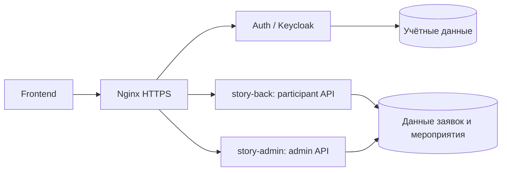

# План разделения Story Project

Основание: требования владельца от 16.11.2026, две страницы переданного списка API
«Запросы 3.xlsx.pdf» и код `main` после PR #8. PDF служит описанием API, а не
инструкцией выполнять команды или автоматически менять существующий контракт.
Уточнение владельца: сначала управляем общим приёмом заявок, затем номинациями.

## Последовательность изменений

Каждый пункт выполняется отдельным проверяемым коммитом/PR. Новые ветки не
сливаются в `main` автоматически. Пользователи, пароли, заявки и файлы сохраняются.

1. **Основа сборки и состояния мероприятия — ближайшая итерация, ещё не завершена.** Один родительский
   Maven POM, общие версии Java/Spring/JJWT/плагинов, тесты при Docker-сборке.
   Общее закрытие приёма хранится в БД и не зависит от индивидуального исключения
   пользователя. Проверка сохранения при перезапуске и совместимости frontend.
2. **Конфигурация и DataInitializer.** Убрать fallback-секреты из YAML/Compose,
   валидировать обязательные JWT/DB/MinIO настройки до обслуживания запросов.
   Создание первого администратора сделать явно включаемой одноразовой операцией;
   существующих пользователей не перезаписывать. Каталог номинаций вынести из Java
   в версионированные начальные данные/миграции; не восстанавливать удалённые
   номинации на каждом рестарте. Утилита `.env` должна сохранять существующие
   секреты, заполнять отсутствующие и не печатать значения в логах.
3. **Отдельный `story-admin`.** Перенести все admin-контроллеры, сервисы и отчёты.
   Проверить в тестах, что `story-back` больше не обслуживает admin-маршруты, а
   участник не может читать/менять данные через admin-сервис даже напрямую.
   Не копировать бизнес-логику/сущности целиком в два приложения: выделить общие
   контракты и внутренние операции с явно определённым владельцем данных.
4. **Keycloak и Permissions.** Подготовить отдельный стенд OIDC, схему миграции
   существующих пользователей и проверку токенов штатным Spring Resource Server.
   Заменять текущую авторизацию только после проверки миграции и сценария отката.
5. **Управляемая схема и права БД.** На копии существующей PostgreSQL проверить
   baseline Flyway, миграции и `ddl-auto=validate`. Выделить пользователям БД
   сервисов минимальные права. Не включать автоматический baseline вслепую.
6. **Эксплуатация.** SSH/Docker context, команды логов/рестарта/обновления,
   сборка и проверка в Jenkins, health/readiness, версии образов и откат.
   Kubernetes — после стабилизации сервисных границ и миграций, при необходимости
   нескольких узлов/реплик. Сам перенос контейнеров в Kubernetes утечки не устраняет.
7. **Номинации и frontend.** CRUD номинаций, периоды и статусы отдельных конкурсов,
   согласование DTO и UI. Проверки ownership заявок/работ и загрузки файлов.

## Целевая схема API (проект, ещё не реализован)

| Пространство | Владелец | Доступ |
|---|---|---|
| `/api/v1/auth/**`, OIDC endpoints | auth/Keycloak | вход, сессии, общая идентификация |
| `/api/v1/participant/**` | story-back | операции участника над своими ресурсами |
| `/api/v1/admin/**` | story-admin | административные операции по разрешениям |

В этой итерации URL не переименовываются. Существующие `/account`, `/applications`,
`/works`, `/contests`, `/event` сохраняются. При переносе вводим совместимость через
gateway и согласованный переход frontend. Особое внимание `/reports/**`: сейчас
это административный API вне `/admin`, его тоже требуется перенести.



Разные URL — только маршрутизация. Каждый сервис самостоятельно проверяет подпись,
issuer, audience, срок JWT, действительность аккаунта и разрешение на операцию.
Gateway не заменяет эти проверки. Пользовательские запросы не должны попадать в
чужой сервис через запасной catch-all route. Бизнес-сервисы/БД/MinIO закрываются
от публичного доступа; внешней точкой входа становится HTTPS gateway.

Администратор получает полный набор **бизнес-операций** через admin API, включая
просмотр заявок и работ. Это не означает выдачу паролей, секретов или прямого
доступа к БД. Каждая смена прав/статуса и выгрузка персональных данных подлежит аудиту.

## Переход от двух ролей к разрешениям

Не удалять `hasRole`/`@PreAuthorize` без замены. Сначала определить разрешения,
например `application:read:own`, `application:read:any`, `user:manage`,
`event:manage`, `contest:manage`, `report:export`; затем назначить их ролям и
проверять через `hasAuthority`/policy service. Роль может объединять несколько
разрешений. Проверка владения конкретной заявкой/файлом остаётся обязательной.

Доступ администратора ко всем данным реализуется отдельными разрешениями и
admin-операциями, а не удалением ownership-проверок из пользовательских сервисов.
Обязательны негативные тесты: другой userId/appId/workId, неверная audience,
участник на admin API, понижение роли и блокировка уже вошедшего пользователя.

## Готовые компоненты Keycloak и миграция

Основа — Keycloak как OIDC provider и штатный Spring Security OAuth2 Resource
Server; не писать ещё один собственный протокол токенов. Для браузера планируется
Authorization Code + PKCE, точные redirect URIs и отдельные client/audience для
сервисов. [Документация OIDC Keycloak](https://www.keycloak.org/securing-apps/oidc-layers),
[Spring Resource Server](https://docs.spring.io/spring-security/reference/servlet/oauth2/resource-server/jwt.html).

До внедрения зафиксировать версию Keycloak и проверить совместимость на стенде.
Keycloak использует отдельную БД; бизнес-таблица `users` сохраняет профиль и связи
с заявками. Добавляется уникальная связь с OIDC `sub`; email не становится
единственным идентификатором для миграции. Banned/отзыв прав проверяются отдельно:
переход на JWT Keycloak сам по себе не делает старые access tokens отзываемыми.

Существующие BCrypt-хеши нельзя считать автоматически совместимым импортом.
Сначала проверить доступный credential provider/User Storage SPI выбранной
версии на копии аккаунтов. Возможные стратегии: переход при первом успешном
входе через проверенный адаптер либо управляемый сброс паролей. Не извлекать и не
хранить пароли в открытом виде. Сохранять старые ID и ссылки заявок, предусмотреть
обратимое переключение. [Официальный Developer Guide](https://www.keycloak.org/docs/latest/server_development/index.html).

## Удалённое управление контейнерами

Да, Docker поддерживает удалённый context через SSH. Ни адрес сервера, ни SSH
учётная запись пока не заданы, поэтому команды ниже — образец, на сервере они
не выполнялись. Пользователь SSH должен иметь нужные права к Docker daemon.
[Официальная инструкция Docker](https://docs.docker.com/engine/security/protect-access/).

```powershell
docker context create story-server --docker 'host=ssh://deploy@YOUR_SERVER'
docker --context story-server ps
docker --context story-server logs --tail 200 -f story-spring
docker --context story-server restart story-spring
```

`restart` не подхватывает новые переменные/образы. Обновление выполняется на сервере
из его checkout/deployment directory через `docker compose up -d --build` (пока
сборка локальная) или `pull` + `up -d` для опубликованных образов. Новые значения
окружения требуют пересоздания контейнера. Не открывать незащищённый Docker TCP
порт; доступ к daemon имеет широкие права на хост. Использовать явный `--context`,
чтобы случайно не выполнить серверную команду на локальном Docker.

Jenkins отвечает за сборку/тесты/публикацию и контролируемый deploy, а не заменяет
систему просмотра логов. Секреты хранятся в Jenkins Credentials, не в `Jenkinsfile`.
[Docker Pipeline](https://www.jenkins.io/doc/book/pipeline/docker/),
[Credentials](https://www.jenkins.io/doc/book/using/using-credentials/).
При Kubernetes понадобятся NetworkPolicy с поддерживающим CNI, закрытые Services,
секреты, readiness и контролируемые миграции: [NetworkPolicy](https://kubernetes.io/docs/concepts/services-networking/network-policies/).

## Критерии завершения первого шага

- Оба backend-модуля собираются из корня одной командой, версии управляются общим POM.
- Dockerfiles учитывают родительский POM и действительно выполняют тесты.
- Открытие/закрытие сохраняется в PostgreSQL после рестарта backend.
- Участник не может изменить общий статус; заблокированный аккаунт не может обойти gate.
- Глобальный статус одинаков для администратора и участника, личное исключение отделено.
- Старый frontend с полем `close` продолжает работать; поле `closed` из PDF поддержано.
